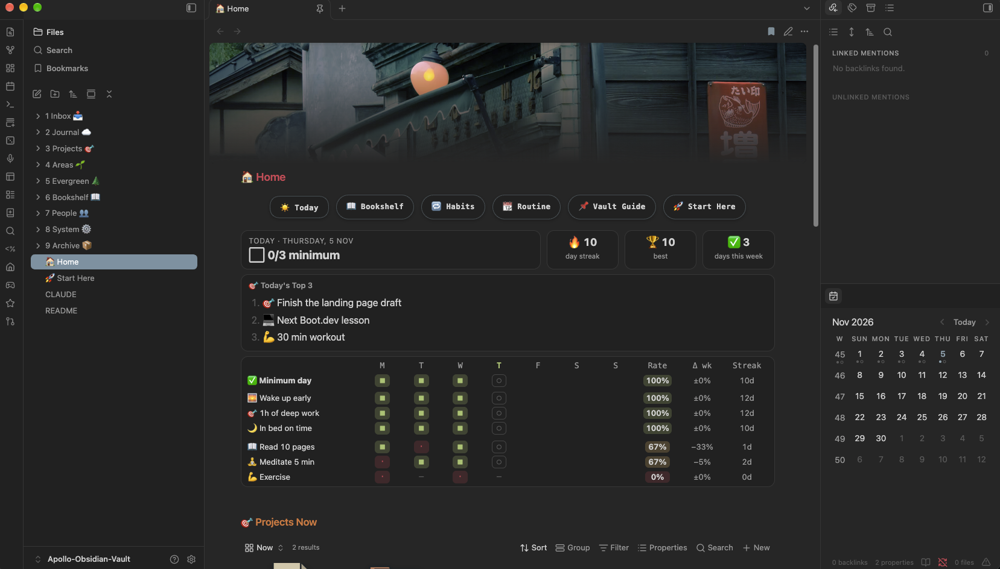

# 🚀 Apollo Obsidian Vault

**An opinionated, ready-to-use Obsidian vault.** Download it, open it, and start writing: folders, note types, templates, a habit tracker and a media bookshelf are already set up and wired together.

Think of it like what [Omarchy](https://omarchy.org) is for Arch Linux: one person's carefully tuned setup, so you don't spend your first month building a system before you can use it.



| A project page | The bookshelf | The habit tracker |
|---|---|---|
|  |  |  |

---

## ✨ What you get
- **🗂️ Folders + links + categories, together.** PARA-style numbered folders (`1 Inbox` → `9 Archive`) you can see, Zettelkasten-style linking, and [Kepano-style](https://stephango.com/vault) categories with live Bases on top.
- **🧭 Notes that file themselves.** Templates ask *"what is this about?"*, fill in the properties and move the note into the right project or area.
- **🎯 Projects and 🌱 Areas** with dashboard pages that collect every related note in tabs: sources, YouTube videos (with thumbnails), how-tos, writing, ideas.
- **🎓 A course system**: course → module → chapter, with one-click buttons for each level.
- **🔁 A habit tracker** on your Home page: a "Minimum Day", streaks, "never miss twice", a week grid, a heatmap and number goals (steps, screen time…). **Set your habits by editing one table**, no code.
- **📖 A bookshelf** for books, manga, movies, TV shows, anime and games. Search by title and the cover, author, director, genres and release date are filled in for you. Each shelf has its own look: book spines, manga paperbacks, streaming posters, game cases.
- **☀️ Daily and weekly notes** with "Tomorrow's Top 3" and a 15-minute weekly review.
- **🎨 Minimal and calm.** Built on the Minimal theme; every accent follows the colour scheme you pick, in light and dark mode.
- **🤖 AI-ready.** `CLAUDE.md` plus a small docs folder let an AI assistant understand the vault and change it safely.
- **🧳 Bring your old notes.** Copy your existing vault into the Inbox and an AI assistant sorts it into Apollo in one go: projects, areas, courses, sources, daily notes. Every move is logged and can be undone.

## ⭐ How you use it
One shortcut does almost everything: **`Cmd+Option+Shift+N`** (`Ctrl+Alt+Shift+N` on Windows/Linux).

1. Press it and **pick what kind of note** it is: 📚 a source (something from the internet), ⚛️ a quick fact, 🌲 your own idea, ✍️ something you're writing, 🤝 a meeting, 👤 a person, 🎯 a project, 🌱 an area, 🎓 a course.
2. **Pick the area or project** it belongs to.
3. **Type a title.** The note fills in its own properties, moves into the right folder and shows up on that project's or area's page.

Books, movies, anime and games come from one-click search buttons. Daily notes come from ☀️ Today on Home.

## 📥 Install
1. **Download** this repo: green **Code** button → **Download ZIP**, then unzip it. Or:
   ```bash
   git clone <this-repo-url> "Apollo"
   ```
2. **Open it in [Obsidian](https://obsidian.md)** (version **1.13.1 or newer**): *Open folder as vault* → pick the folder.
3. Open **`🚀 Start Here`** and follow the 5 short steps: turn on community plugins (*Trust author*), restart, flip one Templater setting, and optionally add free API keys for movie and game search.

That's it. The full manual is in the vault: **📌 Vault Guide** (button on Home).

**Coming from another vault?** Copy your notes into `1 Inbox 📥/📦 Import/` and ask an AI that can edit files (the Claude desktop app, Claude Code, Cursor, or an Obsidian agent plugin like Claudian) to *"read CLAUDE.md, then follow `8 System ⚙️/🤖 AI/import.md`"*. Details are in the Vault Guide → 🧳 Bring your old vault.

> **Keep your fork private if you add API keys.** Movie and game search keys are saved in `.obsidian/plugins/*/data.json`.

## 🗺️ Inside
| Folder | What goes in it |
|---|---|
| `1 Inbox 📥` | Quick captures, sorted weekly |
| `2 Journal ☁️` | Daily and weekly notes |
| `3 Projects 🎯` | Things with a finish line |
| `4 Areas 🌱` | Things you look after, no end date |
| `5 Evergreen 🌲` | Your own ideas, one per note |
| `6 Bookshelf 📖` | Books, manga, movies, shows, anime, games |
| `7 People 👥` | People, creators, organisations |
| `8 System ⚙️` | Templates, bases, categories, scripts, images, clippings, AI docs |
| `9 Archive 📦` | Finished stuff |

A few sample notes (one project, a couple of areas with a course, some books, movies and games) show how everything looks. Delete them whenever you like.

## 🔌 Included plugins
All free community plugins, bundled so everything works out of the box. Thank you to their authors.

| Plugin | What it does here | Author |
|---|---|---|
| [Templater](https://obsidian.md/plugins?id=templater-obsidian) | The smart templates and topic picker | SilentVoid |
| [Dataview](https://obsidian.md/plugins?id=dataview) | Runs the habit tracker | Michael Brenan |
| [Meta Bind](https://obsidian.md/plugins?id=obsidian-meta-bind-plugin) | Buttons (☀️ Today, ➕ Module, ➕ Chapter…) | Moritz Jung |
| [Homepage](https://obsidian.md/plugins?id=homepage) | Opens 🏠 Home on startup | novov |
| [Book Search + Covers](https://obsidian.md/plugins?id=book-search-covers) | Book and manga notes | lksrpp |
| [Movie Search](https://obsidian.md/plugins?id=movie-search) | Movie, show and anime notes (TMDB) | Gubchik123 |
| [IGDB Game Search](https://obsidian.md/plugins?id=igdb-game-search) | Game notes (IGDB) | tetsuya-dev-jp |
| [Simple Banner](https://obsidian.md/plugins?id=simple-banner) | Banner images on notes | Sandro Ducceschi |
| [Calendar](https://obsidian.md/plugins?id=calendar) | Calendar + weekly notes | Liam Cain |
| [Omnisearch](https://obsidian.md/plugins?id=omnisearch) | Fast, typo-tolerant search | Simon Cambier |
| [Force note view mode](https://obsidian.md/plugins?id=obsidian-view-mode-by-frontmatter) | Journal notes open in Reading view | Benny Wydooghe |
| [Minimal Theme Settings](https://obsidian.md/plugins?id=obsidian-minimal-settings) · [Style Settings](https://obsidian.md/plugins?id=obsidian-style-settings) | Theme options | kepano · mgmeyers |
| [Git](https://obsidian.md/plugins?id=obsidian-git) | Optional backups to Git (manual only) | Vinzent |
| [Better Word Count](https://obsidian.md/plugins?id=better-word-count) · [Image Toolkit](https://obsidian.md/plugins?id=obsidian-image-toolkit) | Word counts · image viewer | Luke Leppan · Xiangru |

**Themes:** [Minimal](https://github.com/kepano/obsidian-minimal) by kepano (default), [Omarchy](https://omarchy.org), and Shiba Inu by [Farouk](https://github.com/faroukx).

<!-- TODO: double-check each plugin/theme licence and link before publishing -->

## 🙏 Inspired by
- [Steph Ango (kepano)'s vault](https://stephango.com/vault): categories and bases
- Tiago Forte's **PARA** method and *Building a Second Brain*
- The **Zettelkasten** method
- [Omarchy](https://omarchy.org): the idea of a beautiful, opinionated setup that works on day one

## 📄 License
[MIT](LICENSE) for the vault's own files (notes, templates, bases, scripts, CSS). The bundled plugins and themes belong to their authors and keep their own licences. The banner images are sample wallpapers collected from the web, credited to their original artists: swap in your own.

---
Made by [Wazzo](https://github.com/WazzoMC)
